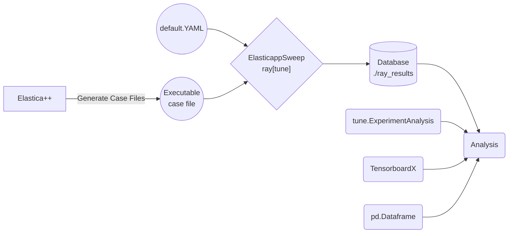

# ElasticappSweep: Tune Elastica++ for Scaling

The purpose of `ElasticappSweep` is to find optimal setting to run `Elastica++` in different environment. It utilize `ray[tune]` library for parameter sweep and data collection.

> This tool will be refactored into separate repository in the future.

## Pipeline



1. `ElasticappSweep` will first collect default configuration/parameters for `Elastica++` execution file, and generate set of configuration-YAML files with the parameter that needs to be sweeped.
    - __Grid-search__ for testing different `block size` and `block policy`.
    - __Scaling__ for testing different `number of elements` and `number of rods`.
    > This configuration-YAML file will be stored along with the output directory, which is entirely managed by `ray[tune]`.
2. The `Elastica++` program will run within each directory with each configuration-YAML.
    - Output files will also be saved in each directory.
    - For each run, an objective (i.e. run time) is saved as a result.
    - Scripts we provide will run each "Trials" serially, because we are measuring the benchmark performance.
        - If want to convert to parallel optimization, you can call `ray.init(num_cpus:int, num_gpus:int)`.
    - Scripts we provided does `grid-search`: _run every combination of sweeping variable_. If wants to convert the algorithm to do `search`: _optimization_, use schedular and search algorithm in `ray[tune]`. [ref](https://docs.ray.io/en/latest/tune/key-concepts.html#search-spaces)
    - To setup non-MPI distributed strategy, checkout [here](https://docs.ray.io/en/latest/tune/tutorials/tune-distributed.html).
    - To setup MPI distributed strategy, checkout [here](https://docs.ray.io/en/latest/cluster/slurm.html).
3. The result will be stored in the directory `./ray_results`.
    - To view the result, user can load the entire directory into `Tensorboard`.
    - To read the result as dataframe, use [`tune.ExperimentAnalysis`](https://docs.ray.io/en/latest/tune/api_docs/analysis.html#experimentanalysis-tune-experimentanalysis) module.
4. Output file structure (example)
    > Directory and file name can be customized by setting `trial_name_creator` and `trial_dirname_creator`. [ref](https://docs.ray.io/en/latest/tune/api_docs/execution.html#tune-run)
```sh
ray_results
└── runner_2022-08-16_17-05-32
    ├── basic-variant-state-2022-08-16_17-05-33.json
    ├── experiment_state-2022-08-16_17-05-33.json         # Experiment state file in dataframe
    ├── runner_8bd84_00000_0_block_policy=policy1,block_size=1_2022-08-16_17-05-33
    │   ├── events.out.tfevents.1660687533  # Tensorboard data file
    │   ├── output.yml                      # Output from Elastica++
    │   ├── params.json                     # Sweep Parameter
    │   ├── params.pkl
    │   ├── progress.csv                    # Current progress (e.g. last objective values, loss, etc.)
    │   └── result.json                     # Result (row of the dataframe)
    ├─── runner_8bd84_00001_1_block_policy=policy2,block_size=1_2022-08-16_17-05-35
    │    ├── events.out.tfevents.1660687535
    │    ├── output.yml
    │    ├── params.json
    │    ├── params.pkl
    │    ├── progress.csv
    │    └── result.json
   ...

3 directories, 14 files
```
     
    
## Analysis (Examples)

### Tensorboard

> Installing `ray[tune]` should also install `TensorboardX`. If not, you can install it using `pip`.

```
tensorboard --logdir=./ray_results
```


### tune.ExperimentAnalysis

> TODO: Might refactor the steps into `ElasticappSweep.dataview()`.

```py
path = "ray_results/runner_2022-08-16_17-05-32/experiment_state-2022-08-16_17-05-33.json"
analysis = tune.ExperimentAnalysis(path)
df = analysis.dataframe()
```

## How-to-run

### Install

```sh
poetry install
```

### Grid-search: varying block-size and block-policy

```sh
python -m ElasticappSweep.cases.grid_search_blocksize_and_policy \
  --execute=<path to executable elastica++ case study file> \
  --default_config=<path to default configuration yaml file> \
```

### Scaling: varying number of element and rods

```sh
python -m ElasticappSweep.cases.scaling_wrt_num_element_and_threading \
  --execute=<path to executable elastica++ case study file> \
  --default_config=<path to default configuration yaml file> \
```
